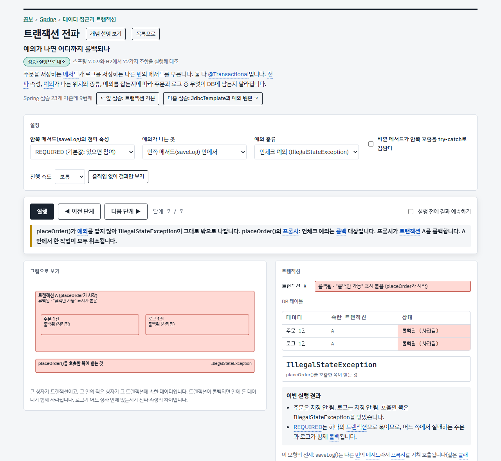
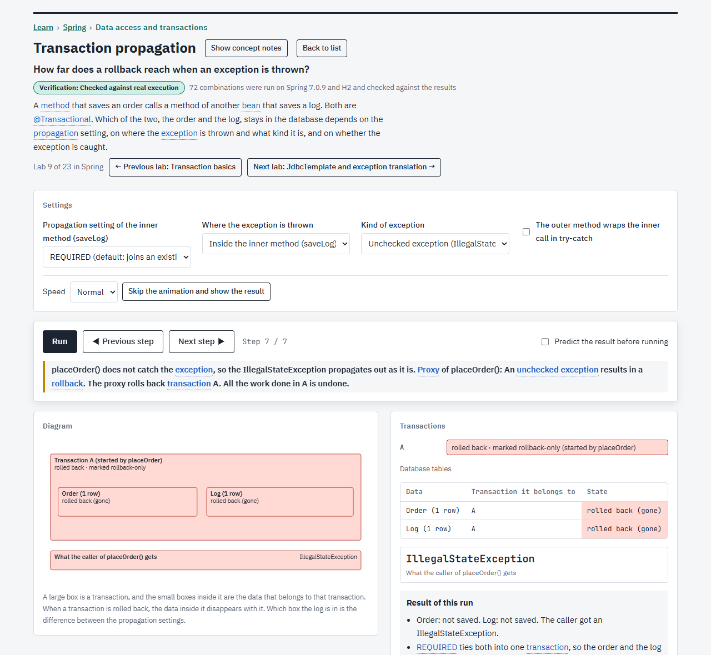

# 개발 학습 실습실 · Dev Learning Lab

### ▶ 바로 써 보기: https://jhb010311.github.io/dev-learning-lab/
### ▶ Try it in English: https://jhb010311.github.io/dev-learning-lab/en/

[](https://jhb010311.github.io/dev-learning-lab/#txprop)

자바, 스프링, JPA, 데이터베이스, 네트워크, 보안의 개념을 **설정을 바꾸고 실행을 눌러** 익히는 무료 실습실입니다.
글로 읽는 대신, 개념 하나가 어떤 순서로 움직이고 어떤 결과를 만드는지를 그림과 함께 단계별로 봅니다.

- 실습 161개, 테스트 문제 591개. 한국어와 영어로 볼 수 있습니다.
- 설치도 가입도 없습니다. 웹 페이지 하나입니다.
- 공부한 기록과 테스트 결과는 브라우저에만 저장됩니다. 서버로 보내는 정보가 없습니다.

**도움이 됐다면 이 페이지 오른쪽 위의 ⭐ Star를 눌러 주세요.** 틀린 내용이나 의견은 [이슈](https://github.com/jhb010311/dev-learning-lab/issues)로 알려 주세요.

[English description below](#english)

## 어떻게 쓰나

1. 위의 주소로 들어가 분야(Java, Spring, JPA, DB, 네트워크, 보안)를 고르고 실습 하나를 엽니다.
2. **실행**을 누릅니다. 그림과 설명이 한 단계씩 넘어갑니다.
3. 결과 아래의 "이렇게 바꿔 보세요"에서 다른 예시를 누르거나 설정을 직접 바꿔, 결과가 어떻게 달라지는지 비교합니다.

예를 들어 위 그림의 [트랜잭션 전파](https://jhb010311.github.io/dev-learning-lab/#txprop) 실습에서는 전파 속성과 예외가 나는 위치를 바꿔 가며, 주문과 로그 가운데 무엇이 DB에 남는지를 봅니다.

## 이것은 무엇이고 무엇이 아닌가

여기의 실습은 실제 서버나 데이터베이스를 돌리는 것이 아니라, **개념의 규칙을 옮긴 모형**입니다.
그래서 실습마다 그 모형을 무엇과 대조해 확인했는지를 제목 아래에 적어 두었습니다.

| 표시 | 뜻 | 실습 수 |
|---|---|---|
| 실행으로 대조 | 같은 상황을 실제 프로그램(JDK, 스프링, Hibernate, MySQL, Redis 등)에서 실행한 결과와 조합마다 맞춰 봄 | 116 |
| 일부만 실행으로 확인 | 원리나 일부 조합만 실행으로 확인함. 수치는 예시 | 20 |
| 문서·표준 대조 | 공식 문서, 표준(RFC), 소스의 규칙을 옮김. 실행해 보지는 않음 | 15 |
| 개념 모형 | 원리를 보이기 위한 모형. 수치는 예시 | 10 |

대조에 쓴 프로그램과 그 출력은 `verify/` 폴더에 있습니다. 틀린 내용을 발견하면 이슈로 알려 주세요.

## 구성

- **공부**: 분야(Java, Spring, JPA, DB, 네트워크, 보안)를 고르면 배울 항목이 차례로 나옵니다.
  목차는 널리 읽히는 책과 공식 문서의 차례를 참고해 짰습니다(어떤 주제를 다루는지만 참고했고 내용을 옮기지 않았습니다).
- **실습**: 설정 → 실행 → 왼쪽 그림과 오른쪽 실행표 → 다른 예시 → 실행 비교. 파란 낱말을 누르면 뜻이 나옵니다.
- **테스트**: 분야별로 기초, 초급, 중급, 응용 단계의 문제를 풉니다. 틀린 문제는 간격을 두고 다시 나옵니다.

## 폴더

```
docs/index.html     웹에 올리는 완성된 페이지 (빌드 결과). docs/en/은 영어판
src/framework.html  화면의 공통 틀
src/lessons/        실습 하나에 파일 하나
src/curriculum.js   분야와 목차
src/quiz*.js        테스트 문제
src/glossary.js     용어 풀이
src/verify*.js      실습별 검증 수준
src/en/             영어판의 글 (실습, 문제, 용어 풀이, 용어 대조표)
kb/                 개념 설명 (kb/en/은 영어)
verify/             모형을 실제 실행과 대조한 프로그램과 출력
tools/              검사 도구 (tools/i18n/은 영어판 검사)
build.js, test.js   빌드와 검사
```

## 직접 빌드하기

Node.js만 있으면 됩니다.

```bash
node build.js
```

```bash
node test.js
```

```bash
node serve.js
```

`build.js`는 형식과 목차, 테스트 문제를 검사한 뒤 `docs/index.html`을 만들고, `test.js`는 모든 실습을 모든 설정 조합으로 돌려 봅니다.
`serve.js`를 실행하면 http://127.0.0.1:4173 에서 미리 볼 수 있습니다. 영어판은 `LAB_LANG=en node build.js`로 만듭니다.

---

<a id="english"></a>

## English

### ▶ Try it: https://jhb010311.github.io/dev-learning-lab/en/

[](https://jhb010311.github.io/dev-learning-lab/en/#txprop)

Dev Learning Lab is a free site for learning Java, Spring, JPA, database, networking, and security concepts **by changing settings and clicking Run**.
Instead of only reading about a concept, you watch step by step, with a diagram, how it behaves and what result it produces.

- 161 labs and 591 quiz questions, in Korean and English.
- Nothing to install and no sign-up. It is a single web page.
- Your progress and quiz results are stored only in your browser. Nothing is sent to a server.

**If the site helped you, please click ⭐ Star at the top right of this page.** To report a mistake or send feedback, open an [issue](https://github.com/jhb010311/dev-learning-lab/issues).

### How to use it

1. Open the site, choose a category (Java, Spring, JPA, Database, Networking, Security), and open a lab.
2. Click **Run**. The diagram and the explanation advance one step at a time.
3. Under the result, click another example in "Try these", or change the settings yourself, and compare how the result changes.

### What it is, and what it is not

The labs do not run a real server or database. Each lab is **a model that reproduces the rules of a concept**.
For that reason, every lab states under its title what the model was checked against.

| Label | Meaning | Labs |
|---|---|---|
| Checked against real execution | The same situation was run in real programs (the JDK, Spring, Hibernate, MySQL, Redis, and others) and compared for every combination of settings | 116 |
| Partly checked against real execution | Only the principle or some combinations were checked by execution. The numbers are examples | 20 |
| Checked against documentation and standards | Follows the rules in official documentation, standards (RFCs), and source code. Not executed | 15 |
| Conceptual model | A model that shows the principle. The numbers are examples | 10 |

The programs used for checking, and their output, are in the `verify/` folder.
The English edition is a translation of the Korean edition; its terms were checked against official documentation and specifications (the list is in `src/en/termbase/`).
